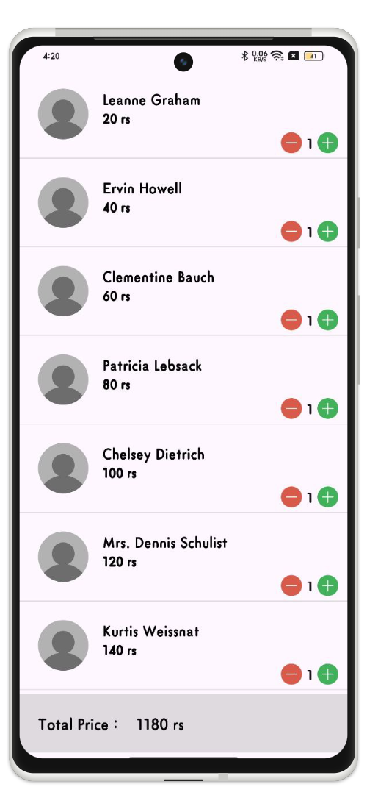

# Android Interview Demo 03
This project is a demonstration of **Android Interview Demo 03** in Kotlin, implementing the MVVM architecture.

## Download
- Pre-built release build is not published yet. You can compile the debug build locally using `./gradlew assembleDebug` (or explore available builds in the root [Releases Catalog](../releases/README.md)).

## Screenshots

    

## **Android Interview Demo Overview**
As part of the interview process, the interviewer would like to assess your coding skills. To do this, they will ask you to submit a short demonstration.

## **What are Interviewers Looking For?**
As discussed during the initial interviews at Jobandtalent, interviewers highly value code quality and maintainability.

## **Consider the Following Points for Your Project:**
The interviewer will ask you to create a simple app that displays a list of items, with a detail screen showing further information. While the task may seem basic, it’s an opportunity for you to demonstrate your skills and knowledge.

Basic Requirements:
- You can use any of the following example APIs: [Dummy API](https://dummyapi.io/), [JSONPlaceholder](https://jsonplaceholder.typicode.com/), [Random Data API](https://random-data-api.com/).
- The app should include a screen that displays a list of items, each showing at least a title, description, or photo.
- When an item is clicked, a detail screen should open, displaying the same information with additional details.
- The interaction is simple: navigate to a detail screen, load the information, and return to the list. Feel free to add any features or modifications that you think will highlight your knowledge and skills with the Android framework.
- The app must be able to compile and run on an emulator.
- In a separate document or section of the README, include future improvements you would make if given more time, along with the reasoning behind your design decisions. This will help guide the project review and facilitate a more in-depth conversation during the interview.

**IMPORTANT**: We understand that developing an app can take time. For this code test, the goal is not to spend more than 4-6 hours on the project. There is no strict deadline, but we emphasize not dedicating excessive time to this task.

## **Conclusion**
I hope it will help you too.
