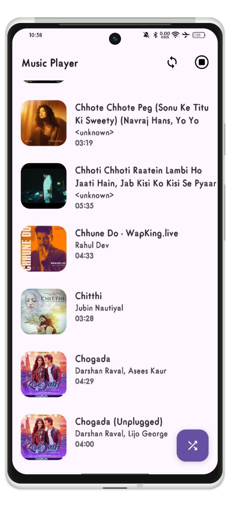
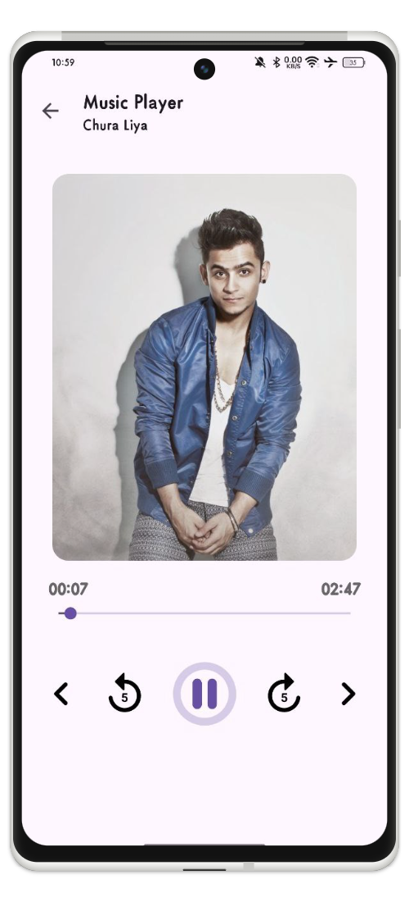

# MusicPlayer
This project is a demonstration of **MusicPlayer** in Kotlin, implementing the MVVM architecture.

## Download
- Download release build APK: [music-player-v1.0.apk](../releases/music-player-v1.0.apk) (see [Releases Catalog](../releases/README.md))

## Screenshots

   
  

